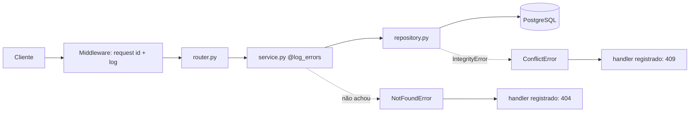
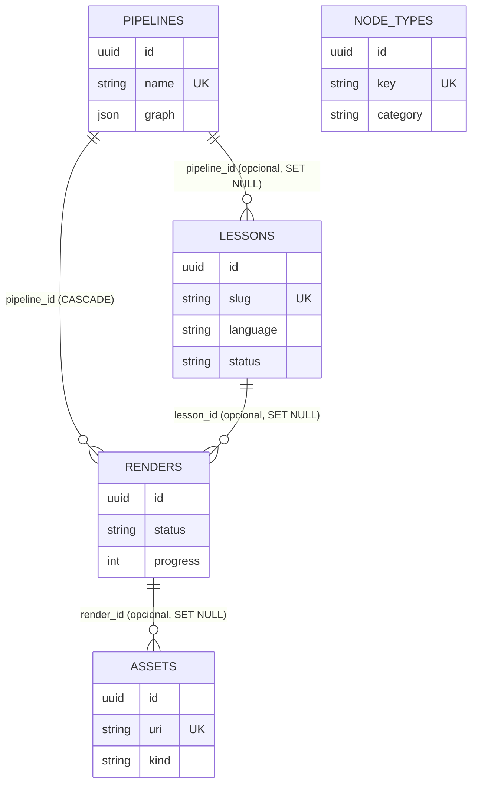

# Arquitetura

## Camadas

Cada recurso vive em `app/<domínio>/` com exatamente cinco arquivos:

| Arquivo | Responsabilidade |
|---|---|
| `router.py` | `APIRouter` fino; também define o provider de DI do próprio domínio (ex.: `PipelineServiceDep`) |
| `schemas.py` | Modelos Pydantic v2: `Create`, `Update` (campos opcionais) e `Read` (`from_attributes`) |
| `models.py` | Classes ORM SQLAlchemy 2.0 (`Mapped[...]`) |
| `service.py` | Regras de negócio, decorado com `@log_errors`; levanta exceções de domínio |
| `repository.py` | Único lugar que conhece SQLAlchemy; traduz `IntegrityError` em `ConflictError` |

Pastas transversais:

- `settings/` - como o app é configurado e observado: `config.py` (pydantic-settings), `logging_config.py`, `middleware.py` (request id, tempo, log por requisição).
- `core/` - maquinário que os domínios usam: `dependencies.py` (só providers cross-domain: sessão, paginação), `decorators.py` (`log_call`, `log_errors`), `exceptions.py` (`NotFoundError`, `ConflictError` e handlers que se registram sozinhos).
- `db/` - `base.py` (Declarative Base), `session.py` (engine async e `get_db_session`), `all_models.py` (importa os models de todos os domínios para o Alembic).
- `workers/` - infraestrutura de fila, fora do padrão de domínio (ver [workers.md](workers.md)).

Regra de import: `core/` nunca importa de `<domínio>/`; só o contrário. Providers de DI específicos de um domínio ficam no `router.py` dele para evitar ciclos.

## Tree de arquivos

```
derivaai_backend/
├── .env.example
├── .gitignore
├── .python-version
├── AGENTS.md
├── CLAUDE.md
├── README.md
├── alembic.ini
├── pyproject.toml
├── alembic/
│   ├── env.py
│   ├── script.py.mako
│   └── versions/
├── app/
│   ├── main.py
│   ├── settings/   config.py, logging_config.py, middleware.py
│   ├── core/       dependencies.py, decorators.py, exceptions.py
│   ├── db/         base.py, session.py, all_models.py
│   ├── pipelines/  router, schemas, models, service, repository
│   ├── lessons/    router, schemas, models, service, repository
│   ├── nodes/      router, schemas, models, service, repository
│   ├── renders/    router, schemas, models, service, repository
│   ├── assets/     router, schemas, models, service, repository
│   └── workers/    celery_app.py, dispatch.py, executor.py, tasks.py
├── docs/
└── tests/          conftest.py, factories.py, test_<domínio>.py, test_executor.py, test_decorators.py
```

## `main.py`

Ordem de montagem: `setup_logging` -> `FastAPI()` -> `register_middleware` -> `register_exception_handlers` -> um `include_router` por domínio. Endpoint `GET /health` retorna `{"status": "ok"}`.

## Fluxo de uma requisição



## Modelo de dados



`node_types` é um catálogo independente: o grafo de um pipeline referencia tipos pelo campo `type` dos nós, sem chave estrangeira.
