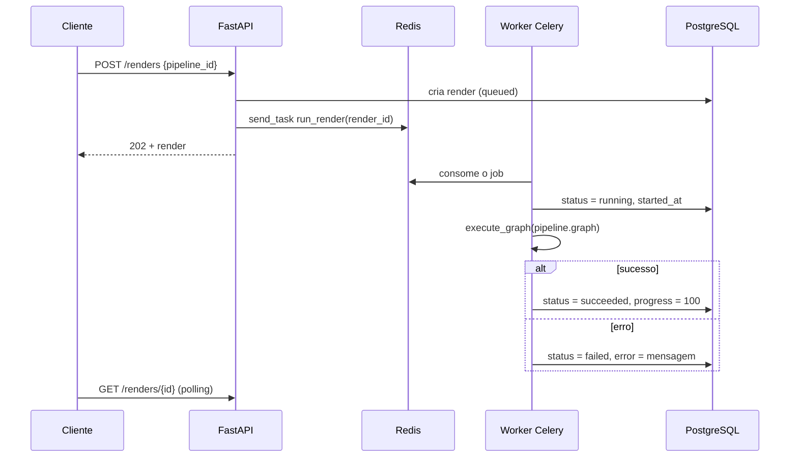

# Workers

`app/workers/` é infraestrutura de fila e execução; não segue o padrão de cinco arquivos dos domínios.

| Arquivo | Papel |
|---|---|
| `celery_app.py` | Instância Celery; broker e backend em `REDIS_URL`; fila padrão `REDIS_QUEUE_NAME` (`derivaai-renders`); `CELERY_TASK_ALWAYS_EAGER` para rodar síncrono em dev/teste |
| `dispatch.py` | `enqueue_render(render_id)`: envia a task **pelo nome** (`send_task`), para a API nunca importar o corpo das tasks (evita ciclos) |
| `executor.py` | Executor puro de grafos, sem I/O de banco |
| `tasks.py` | Task `app.workers.tasks.run_render`: atualiza o render e chama o executor |

## Ciclo de vida de um render

A task cria um engine próprio com `NullPool` a cada execução, porque `asyncio.run` abre um event loop novo por task e conexões de pool não podem ser reaproveitadas entre loops.

## Executor de grafos

- Entrada: `graph = {"nodes": [{"id", "type", "data"}], "edges": [{"source", "target"}]}` (formato React Flow).
- `topological_order(nodes, edges)` ordena por Kahn; ciclo levanta `CycleError`.
- `execute_graph(graph, on_progress)` roda os nós na ordem; a entrada de cada nó é a união das saídas dos nós de origem das arestas que chegam nele; reporta progresso (% de nós concluídos).
- Tipo sem handler levanta `UnknownNodeTypeError`. Todos os erros herdam de `PipelineError`.

## Handlers de nós

Registrados com o decorator `@node_handler("tipo")`, assinatura `handler(data: dict, inputs: dict) -> dict`.

Hoje existe apenas `passthrough` (devolve `inputs` + `data`). Os nós reais entram nas fatias do [roadmap](roadmap-mvp.md):

| Tipo previsto | Função |
|---|---|
| `sympy.solve` | Resolver equações/EDOs simbolicamente |
| `plot.matplotlib` | Gráficos em PNG |
| `tts.narrate` | Narração em pt-BR/en |
| `manim.scene` | Animações |
| `ffmpeg.compose` | Composição do vídeo final |
